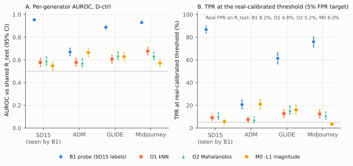
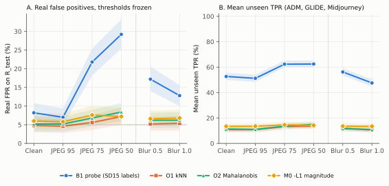
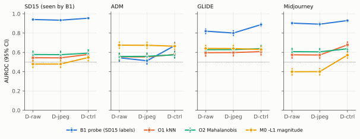
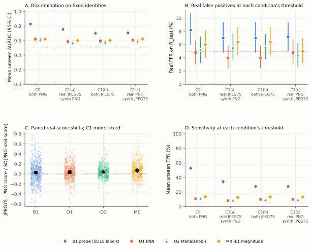
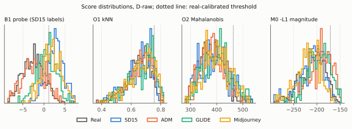
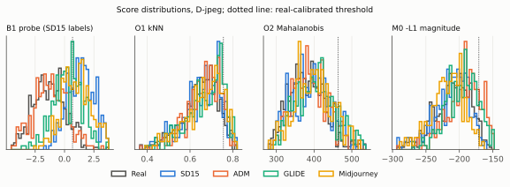
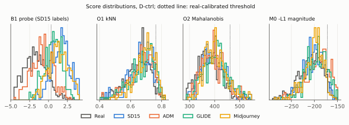
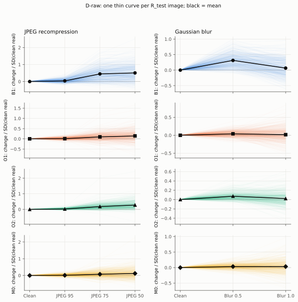
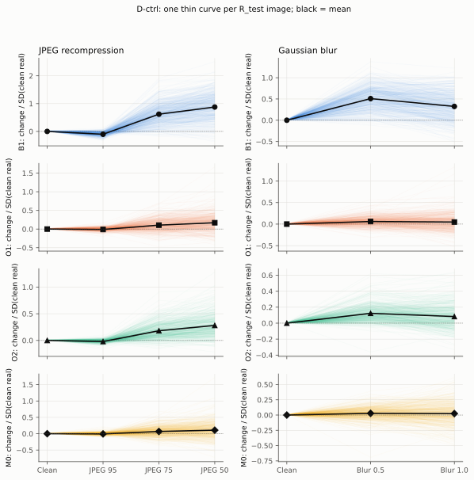

# Does Real-Only Modeling Improve Unseen-Generator Detection?

## A Controlled Study with Frozen DINOv2 Features

> **Key finding:** On the evaluated Tiny-GenImage derivative, a supervised probe trained with images from one known generator outperforms three real-only scoring methods on three held-out generators. Real-only methods produce more stable false-positive rates under JPEG recompression and blur, but detect very few synthetic images at the chosen operating point. The dataset itself also contains a severe stored-format shortcut.

## Research questions

**Can modeling only real images improve detection of unseen synthetic image generators, compared with a binary classifier trained on just one synthetic generator?** Four related questions:

1. Does real-only scoring achieve higher absolute AUROC against held-out generators?
2. Do representation-magnitude and real-reference distances make different errors?
3. Can real-only scoring keep the real false-positive rate stable under JPEG and blur, without sacrificing useful detection sensitivity?
4. How do stored-file format and preprocessing choices affect the measurement?

All tests use frozen global representations; pixel-space reconstruction and patch-level localization are outside the scope.

## Study design

| Component                    | Protocol                                                                                                                                          |
| ---------------------------- | ------------------------------------------------------------------------------------------------------------------------------------------------- |
| Dataset                      | [TheKernel01/Tiny-GenImage](https://huggingface.co/datasets/TheKernel01/Tiny-GenImage), fixed revision `89c4fe9efd0ebc7ce5c7641ef57d578ccd639c69` |
| Encoder                      | Frozen DINOv2 ViT-S/14, with ViT-B/14 secondary check                                                                                             |
| Reference training           | `R_train`: 2,000 authentic images                                                                                                                 |
| Seen synthetic training      | `F_seen_train`: 1,986 Stable Diffusion 1.5 images, used only by B1                                                                                |
| Calibration                  | `R_cal`: 500 separate authentic images; nominal 5% FPR target                                                                                     |
| Evaluation                   | `R_test`: 500 authentic images; 300 each from SD15, ADM, GLIDE, Midjourney                                                                        |
| Unseen generators            | ADM, GLIDE and Midjourney (absent from B1 synthetic training)                                                                                     |
| Primary processing condition | D-ctrl: aligned native-resolution crop with JPEG-history harmonization                                                                            |
| Statistics                   | 2,000 shared, paired bootstrap resamples of test identities; 95% percentile intervals                                                             |

The source derivative has no SD 1.4 examples, despite listing SD14 in its schema; SD15 was substituted in the recorded protocol. “Unseen” refers only to the synthetic images used to train B1.

### Four detection scores

| ID     | Score                                                                           | Uses synthetic labels for fitting? |
| ------ | ------------------------------------------------------------------------------- | ---------------------------------- |
| **B1** | Logistic-regression decision score on L2-normalized post-LN DINOv2 CLS features | Yes, SD15                          |
| **O1** | Distance to the 5th-nearest real reference in normalized CLS space              | No                                 |
| **O2** | Ledoit–Wolf shrinkage Mahalanobis distance from real references                 | No                                 |
| **M0** | Negative pre-LayerNorm CLS L1 magnitude, fixed orientation                      | No                                 |

All thresholds are calibrated on the real-only `R_cal`; detection occurs when the score exceeds the fitted threshold.

## 1. Unseen-generator generalization



*Figure F1. Left: AUROC by generator; right: true-positive rate at real-calibrated thresholds. Error bars: paired bootstrap 95% intervals.*

| Method | SD15 (seen) | ADM   | GLIDE | Midjourney | Mean unseen AUROC (95% CI)     |
| ------ | -----------:| -----:| -----:| ----------:| ------------------------------:|
| B1     | 0.955       | 0.670 | 0.888 | 0.930      | 0.829 [0.809, 0.850]           |
| O1     | 0.579       | 0.578 | 0.608 | 0.678      | 0.621 [0.591, 0.651]           |
| O2     | 0.592       | 0.575 | 0.639 | 0.638      | 0.617 [0.585, 0.646]           |
| M0     | 0.547       | 0.664 | 0.630 | 0.572      | 0.622 [0.592, 0.652]           |

At thresholds targeting a 5% FPR, unseen TPR is 52.7% for B1 but only 10.8%, 11.3% and 13.4% for O1, O2 and M0. The actual clean-test real FPR is 8.2% for B1, versus 4.8%, 5.2% and 6.0% for the real-only scores. M0 even scores higher on unseen generators than on SD15 (0.622 vs 0.547); with both values this low, the seen-to-unseen change says little about generalization.

The primary B1-minus-M0 mean unseen AUROC difference is 0.207 [0.169, 0.246]. With the secondary ViT-B/14 backbone, B1 still leads: mean unseen AUROC 0.845, versus 0.573 (O1), 0.613 (O2) and 0.727 (M0).

## 2. Benign post-processing



*Figure F2. Clean-fitted models and thresholds are held fixed across JPEG quality 95, 75, 50 and Gaussian blur σ=0.5, 1.0. Both false-positive and true-positive responses are shown.*

| Method | Clean FPR | JPEG Q75 FPR | JPEG Q50 FPR | Blur 0.5 FPR | Blur 1.0 FPR |
| ------ | ---------:| ------------:| ------------:| ------------:| ------------:|
| B1     | 8.2%      | 21.8%        | 29.2%        | 17.2%        | 12.8%        |
| O1     | 4.8%      | 5.6%         | 7.2%         | 5.2%         | 5.4%         |
| O2     | 5.2%      | 6.8%         | 8.4%         | 6.2%         | 6.2%         |
| M0     | 6.0%      | 7.6%         | 7.2%         | 6.6%         | 6.8%         |

JPEG Q50 increases B1's real FPR by 21.0 percentage points (95% CI [17.6, 24.6]). The real-only scores move much less, but their detection sensitivity stays very low, so the comparison is a trade-off between stable false alarms and sensitivity.

## 3. Preprocessing and encoding shortcuts



*Figure F3. For each generator, compares D-raw, D-jpeg and D-ctrl. D-native was added post hoc and appears only in the table below.*

| Method | D-raw unseen AUROC | D-jpeg | D-native (post hoc) | D-ctrl |
| ------ | ------------------:| ------:| -------------------:| ------:|
| B1     | 0.756              | 0.735  | 0.838               | 0.829  |
| O1     | 0.575              | 0.575  | 0.620               | 0.621  |
| O2     | 0.597              | 0.598  | 0.618               | 0.617  |
| M0     | 0.572              | 0.571  | 0.622               | 0.622  |

Switching from resized inputs to native crops changes B1 more than the mild JPEG Q96 harmonization does (+0.094 [0.080, 0.108] versus −0.020 [−0.027, −0.014]); native crops raise the real-only scores by 0.019 to 0.051. Native crops also change the field of view, so resampling and image content cannot be separated here.

Stored format alone reveals the label: every authentic image in the derivative is stored as JPEG and every synthetic image as PNG, and a metadata-only baseline reaches AUROC 1.000. Compression traces survive decoding, which is why D-jpeg and D-ctrl harmonize the JPEG history.

**Injected encoding cue.** The C0 model is the D-ctrl setup with both classes stored as lossless PNG. The C1 model is refitted and recalibrated with the real training and calibration images re-encoded as JPEG Q75, while the SD15 training images stay PNG. C1 is then tested with (a) real JPEG Q75 and synthetic PNG (cue kept), (b) both classes JPEG Q75, and (c) real PNG and synthetic JPEG Q75 (cue inverted).



*Figure F4. Panels: AUROC on fixed identities, real FPR at each condition's threshold, paired real-score shifts under the fixed C1 model, and TPR at each condition's threshold.*

The B1 mean unseen AUROC changes from 0.829 for C0 to 0.754, 0.701 and 0.708 for C1(a), C1(b) and C1(c). Part of this drop comes from refitting: with both test classes left as PNG, the C1 model already scores 0.070 [0.057, 0.082] below C0 (post hoc decomposition). Holding the C1 model fixed, JPEG-coding the synthetic test images (C1a → C1b) costs a further 0.053 [0.048, 0.059], while JPEG-coding only the real test images changes AUROC by −0.005 [−0.010, −0.001].

## 4. Reference reseeding (post hoc)

After the main experiment, `R_train` was redrawn with seeds 7, 13 and 29, in addition to the frozen seed 42. The seen synthetic training set, real calibration/test sets, and synthetic test identities were kept fixed. B1/O1/O2 were refitted; M0 does not depend on the reference set.

| Method | Seed 42 | Seed 7 | Seed 13 | Seed 29 | Range |
| ------ | -------:| ------:| -------:| -------:| -----:|
| B1     | 0.829   | 0.846  | 0.833   | 0.822   | 0.025 |
| O1     | 0.621   | 0.628  | 0.621   | 0.624   | 0.007 |
| O2     | 0.617   | 0.636  | 0.622   | 0.611   | 0.025 |
| M0     | 0.622   | 0.622  | 0.622   | 0.622   | 0.000 |

On every draw B1 exceeds each real-only score by at least 0.198 AUROC (seed 29, B1 minus O1, 95% CI [0.166, 0.230]), and no paired interval falls below 0.161. B1's clean real FPR stays between 8.2% and 8.8%. The draws overlap and share the calibration and test sets, so this checks sensitivity to the reference sample only.

Results: [AUROC](artifacts/tables/posthoc_reseed_auroc.csv) · [paired contrasts](artifacts/tables/posthoc_reseed_differences.csv) · [TPR/FPR](artifacts/tables/posthoc_reseed_operating_points.csv).

## Supplementary visual evidence

<details>
<summary><strong>S1: Score distributions for three data conditions</strong></summary>

**D-raw**



**D-jpeg**



**D-ctrl**



</details>

<details>
<summary><strong>S2: Per-image real-score changes under JPEG and blur</strong></summary>

The thin lines show within-image changes for the same held-out real image; the black line is their mean. Shifts are standardized by each method's clean real-test score standard deviation. Neither the model score nor threshold was standardized for evaluation.

**D-raw**



**D-ctrl**



</details>

## Code and reproduction

This repository contains the experiment code, configurations, frozen splits, saved predictions and figures of the study.

- [`src/`](src/): dataset auditing, duplicate grouping, deterministic partitioning, frozen DINOv2 feature extraction, B1/O1/O2/M0 scoring, calibration, E1 to E3 experiments, the two post hoc runs, analysis and plots.
- [`configs/`](configs/): four protocol configurations and pinned model/dataset revisions.
- [`tests/`](tests/): core checks for preprocessing, split integrity, label isolation and calibration.
- [`artifacts/predictions/`](artifacts/predictions/): compressed final and post hoc prediction records (E1, E2, E3, D-native, reseeding), from which every table and figure is regenerated without model inference. Train-split pilot records are not included.
- [`artifacts/tables/`](artifacts/tables/): selected numerical summary CSVs.
- [`artifacts/manifest.csv`](artifacts/manifest.csv) and [`artifacts/splits.json`](artifacts/splits.json): frozen dataset identities, eligibility information and splits.
- [`report/figures/`](report/figures/): the nine SVG figures shown in this README, generated by `src/figures.py` from the saved predictions.
- [`PROTOCOL.md`](PROTOCOL.md): the study protocol, with the post hoc analyses labeled.

### Recompute analysis and figures from stored predictions

For Python 3.11, in a dedicated environment:

```bash
python -m pip install -r requirements.lock
python -m pytest -q
python src/analysis.py
python src/figures.py
```

These commands regenerate tabular metrics and the figure set from saved predictions. They do not re-run DINOv2 inference or model fitting. Tests that need local view or feature caches skip. On a fresh copy of this repository with the locked environment, `pytest` passes (90 passed, 12 skipped) and the two commands reproduce the committed tables and SVG figures byte for byte. A full raw-data rerun from this repository has not been performed.

### Full experiment reproduction

Obtain the pinned [Tiny-GenImage](https://huggingface.co/datasets/TheKernel01/Tiny-GenImage) Parquet data and official [DINOv2](https://github.com/facebookresearch/dinov2) source/weights, in the paths specified by [`configs/core.yaml`](configs/core.yaml). The E1 to E3 and post hoc entry points refuse to overwrite existing outputs, so a fresh run requires a separate disposable working copy, with the bundled reference predictions moved aside. [REPRODUCIBILITY.md](REPRODUCIBILITY.md) gives the commands and order for every result shown here, including D-native and the reseeding check, and states what has been verified.

## Limitations

- One derivative, one primary frozen DINOv2 backbone, and three held-out synthetic generators.
- Only global class-token scoring is tested; pixel, patch, reconstruction and fine-tuned methods may behave differently.
- Bootstrap intervals resample the fixed test identities and hold the fitted models and thresholds fixed, so they omit training-set and dataset-level variation.
- D-native, the injected-cue decomposition and the `R_train` reseeding were added after the main results and are labeled post hoc.
- Dataset storage differences can make synthetic-image detection benchmark results misleading.

## Data, license, and citation

- **Code** (`src/`, `tests/`, `configs/`) and documentation: [MIT](LICENSE).
- **Dataset-derived files** (everything under `artifacts/` and `report/figures/`, including the manifest with original file names and image hashes, the splits and the per-image prediction records): derived from [Tiny-GenImage](https://huggingface.co/datasets/TheKernel01/Tiny-GenImage) (CC BY-NC-SA 4.0), itself built from GenImage (Zhu et al., NeurIPS 2023). They are released under [CC BY-NC-SA 4.0](https://creativecommons.org/licenses/by-nc-sa/4.0/); see [LICENSE-DATA](LICENSE-DATA).
- No dataset image is included. Attribution and pinned source details: [DATA_CARD.md](DATA_CARD.md).

Citation metadata: [CITATION.cff](CITATION.cff). Please cite it as an unpublished research project.
